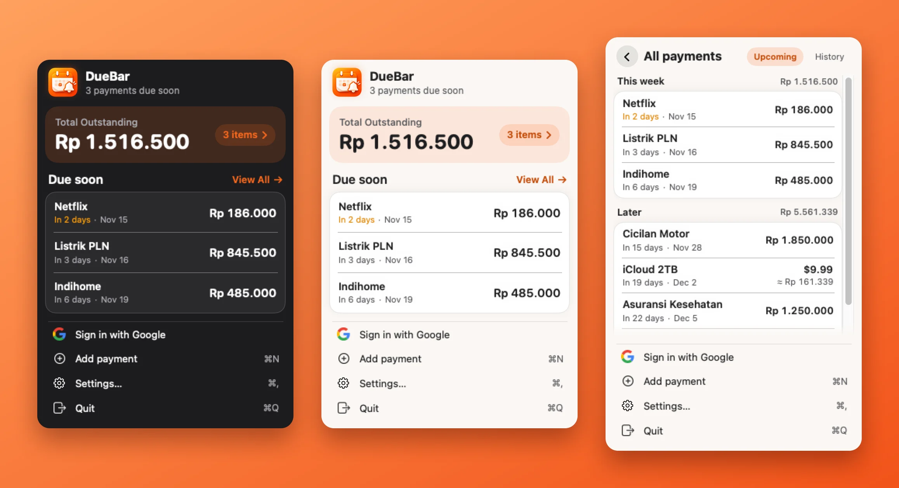
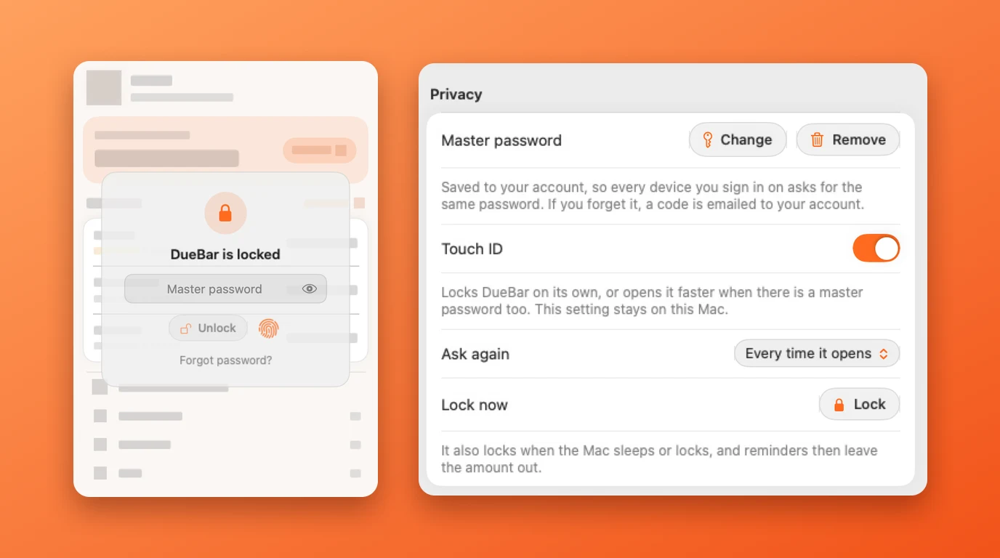

<p align="center"></p>

<h1 align="center">DueBar</h1>

<p align="center">A payment reminder that lives in the macOS menu bar.<br>Bills, subscriptions, installments, insurance and taxes, flagged before they are due.</p>

<p align="center"></p>

## Highlights

- **One number at a glance.** The menu bar shows just the logo with a red badge. Open it for *Total Outstanding* in your main currency, then the payments due soon.
- **Any currency, one total.** Pay in IDR, USD or anything else; DueBar converts to the currency you choose using daily exchange rates.
- **Repeats done right.** Daily to yearly or fully custom, with an end date or count. A bill on the 31st stays on the last day of shorter months.
- **Reminders you can act on.** Notifications before and on the due day, with *Mark as paid* and *Remind me in 1 hour* buttons.
- **Everything in one place.** Search, add, edit, pause and mark payments as paid from Settings, browse the history, and export CSV or back up and restore JSON.
- **Private by default.** Your data stays on your Mac. Sign in with Google only if you want to sync devices.
- **Optional lock.** Hide names and amounts behind a master password, Touch ID, or both ([details](#lock)).
- **Light, dark or system**, in English and Bahasa Indonesia.

## Lock

<p align="center"></p>

Two optional settings, independent of each other (Settings → General → Privacy). Turn on either, or both.

| | Master password | Touch ID |
|---|---|---|
| What it does | Names and amounts stay hidden until you type it | Locks DueBar on its own, or opens it faster next to the password |
| Where it lives | Saved to your account as a salted hash (never the password), so every device asks for the same one, Android included later | This Mac only, never synced |
| Needs a Google sign-in | Yes, because it is stored on the account | No |
| If you forget it | A 6-digit code is emailed to your account (two a day at most) and removes the password on every device | Your Mac's login password opens DueBar when Touch ID is the only lock |

While locked, the dropdown, Settings and the editor stay hidden. DueBar locks again when the Mac sleeps or locks, and you choose whether it asks every time it opens or after 5, 15 or 60 minutes away. Reminders leave the amount out while a lock is on. It is a screen lock, not file encryption.

## Install

Requires macOS 14 (Sonoma) or later.

- **Installer:** download `DueBar.pkg` from the [latest release](https://github.com/ahmadarif-lab/duebar/releases/latest), open it and click through. DueBar lands in Applications.
- **Homebrew:** `brew install --cask ahmadarif-lab/tap/duebar`
- **Disk image:** `DueBar.dmg` from the same release, drag DueBar to Applications.

DueBar is not notarized by Apple yet, so macOS may warn the first time (Homebrew skips the warning): right-click the installer or the app and choose **Open**. DueBar checks for updates itself (Settings → General); with Homebrew, `brew upgrade --cask duebar` works too.

## Sync and privacy

Without signing in, nothing leaves your Mac. Sign in with Google (Settings → Account) to keep payments in sync across devices; an Android app is planned on the same API. DueBar only receives your name, email and profile photo from Google, stores payments encrypted on its server, and *Delete my account and cloud data* removes everything at once. See the [privacy policy](https://apps.ahmadarif.id/duebar/privacy/).

How sync works:

```
DueBar (macOS) ──┐                          ┌── Google (ID token verified by the server)
                 ├── HTTPS ── sync API ─────┤
Android (later) ─┘                          └── DueBar server
```

- Sign-in uses the system browser (OAuth PKCE on a loopback redirect); Google's access and refresh tokens are never stored.
- Each record carries an `updatedAt` and the newest write wins. Deleting leaves a tombstone, and paying the same occurrence on two devices collapses into one history entry.
- Dates are calendar days without a time zone, and money travels as decimal strings.

The wire protocol is in [`docs/sync-api.md`](docs/sync-api.md). The server is a separate private project.

## Build from source

```sh
Scripts/run_dev.sh                  # debug run, with its own data folder
Scripts/build_app.sh                # dist/DueBar.app
swift test                          # model, repeat, merge and lock tests
Scripts/integration_test.sh         # sync tests against the API server (needs a duebar-api checkout)
```

Without a Google client ID the app builds and runs fully local, with sign-in disabled. To enable it, create an OAuth client of type **Desktop app** in Google Cloud Console (scopes `openid email profile`), pass it as `DUEBAR_GOOGLE_CLIENT_ID` and `DUEBAR_GOOGLE_CLIENT_SECRET` to `Scripts/build_app.sh`, and add the same ID to the server's `GOOGLE_CLIENT_IDS`.

```
Sources/DueKit   Models, repeat rules, ledger merge, agenda, reminder planner, sync client (no UI)
Sources/DueBar   AppKit + SwiftUI app (status item, dropdown, editor, settings, notifications)
Tests/DueKitTests
docs/            Sync protocol, README images
```

`DueKit` has no AppKit dependency; the Android app ports its small set of rules (repeat maths, last-write-wins merge) and speaks the same API.

## License

MIT
